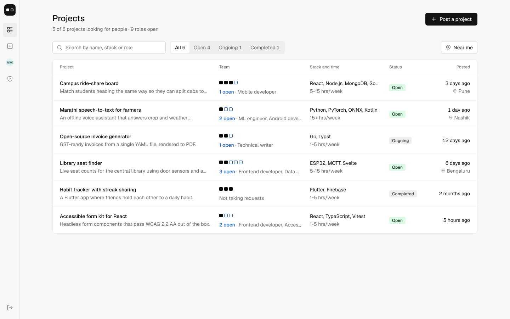
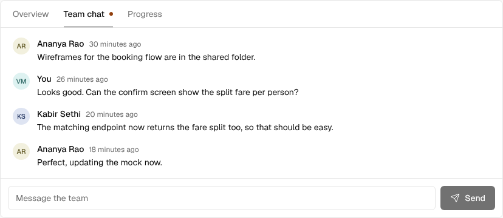
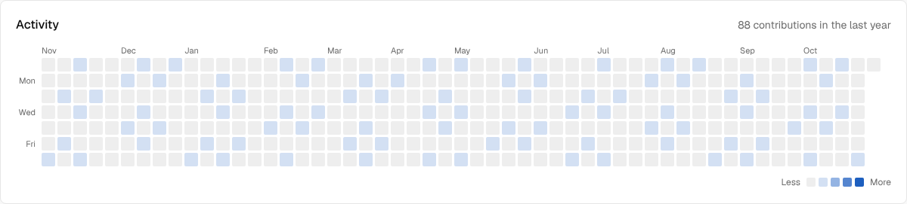
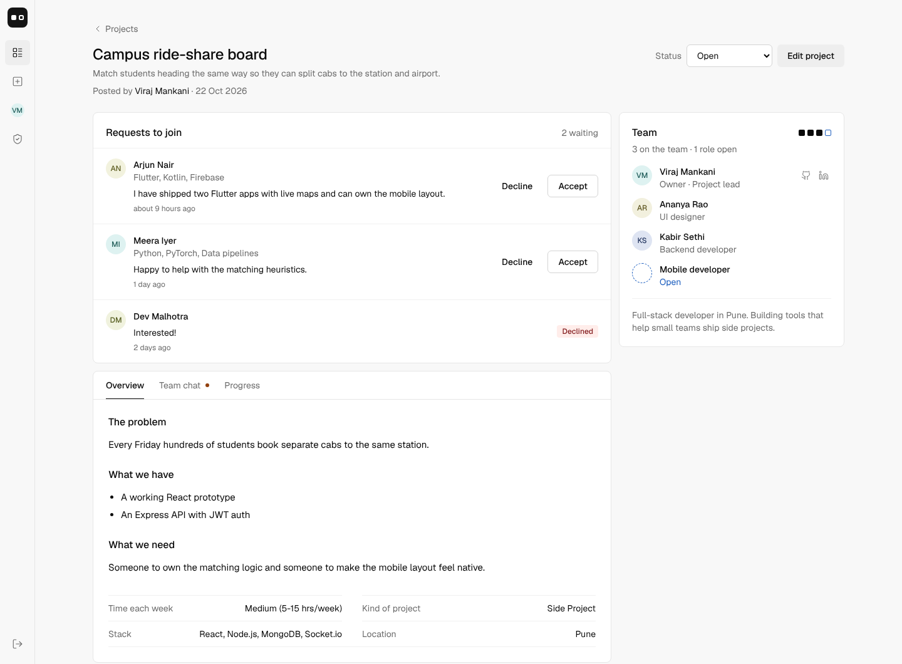
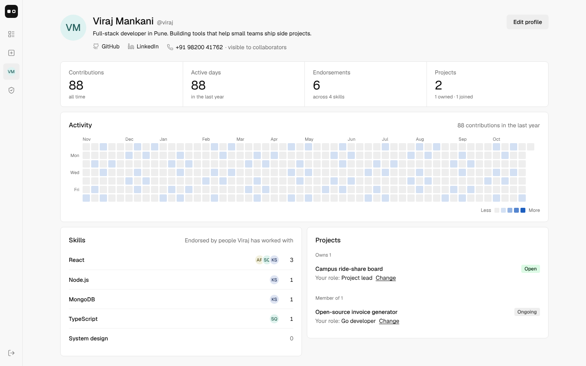
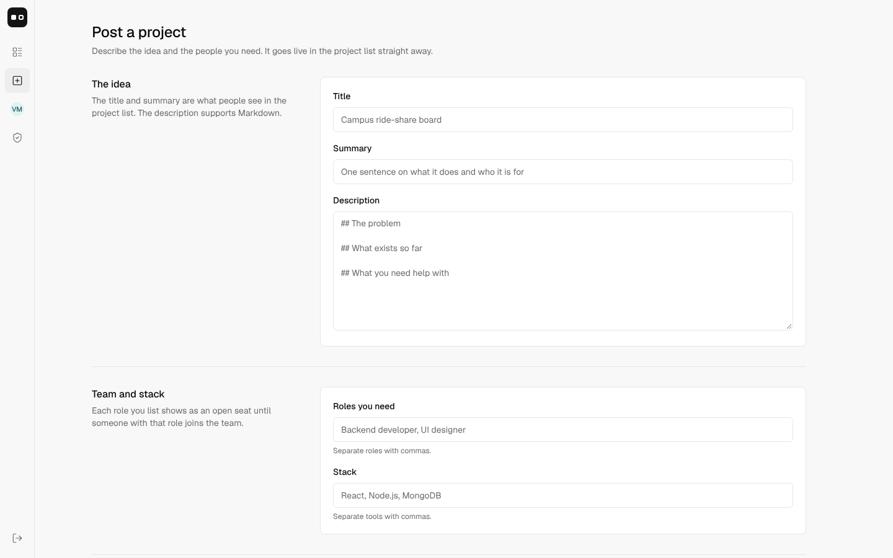
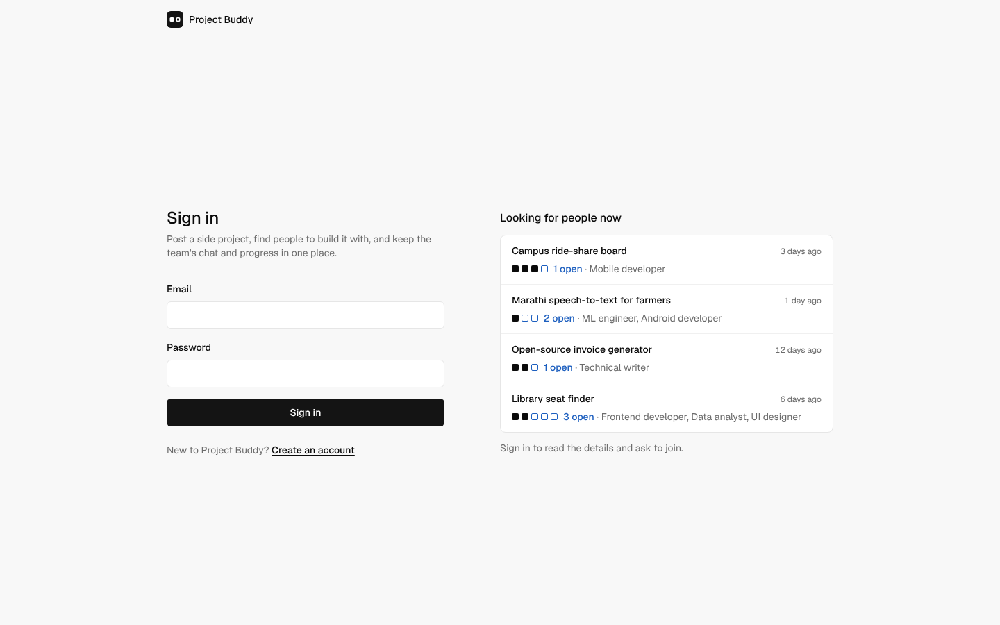
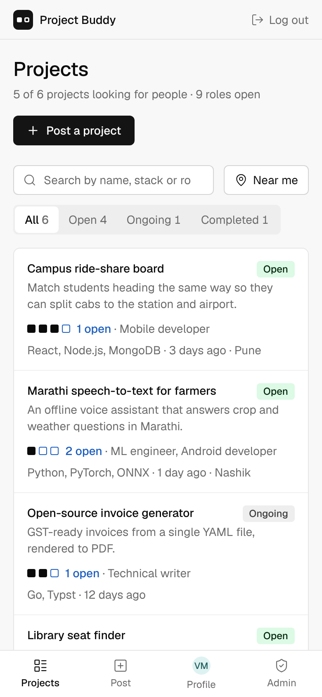

# Project Buddy

A full-stack collaboration platform where developers post side projects,
find people to build them with, talk in real time, and track progress.

**Live Demo:** https://projectbuddy-dzn3.onrender.com

**GitHub:** https://github.com/VirajM723/ProjectBuddy



------------------------------------------------------------------------

## Overview

Project Buddy helps developers connect and collaborate on software
projects. Owners post a project with the roles they need; other users
browse the list, ask to join, and once accepted, work together through a
project chat and a shared progress log. Every contribution feeds a
profile heatmap, and skills can be endorsed by teammates.

The app also supports location-based discovery, and the backend
protects itself against spam and abuse with rate limiting.

## Features

### Authentication

-   Register and sign in with email and password
-   Passwords hashed with bcrypt
-   JWT-protected API routes, with the session restored on page reload
-   Role-based access (members and admins)

------------------------------------------------------------------------

### Projects

-   Post and edit projects: title, summary, Markdown description, tech
    stack, the roles you need, weekly time commitment and project type
-   Search by title, summary, tech stack or role
-   Filter by status (open, ongoing, completed) and by distance with
    **Near me**
-   Every project shows its team at a glance: filled squares for
    members, outlined squares for roles nobody has taken yet

------------------------------------------------------------------------

### Joining a Team

-   Ask to join with a message to the owner
-   Owners see waiting requests at the top of the project page and can
    accept or decline them
-   The team panel lists the owner, each member with their role, and the
    roles that are still open
-   Members set their own role on each project from their profile

------------------------------------------------------------------------

### Team Chat

Each project has a chat room for its owner and members, built on
Socket.IO.

-   Messages arrive instantly for everyone on the team
-   Messages are stored in MongoDB, so history survives reloads
-   Falls back to refreshing every few seconds if the live connection
    drops



------------------------------------------------------------------------

### Progress Log

Team members log milestones and finished tasks on the project's
**Progress** tab. Joining a team is recorded there automatically, so the
log doubles as the project's history.

------------------------------------------------------------------------

### Contribution Heatmap

A GitHub-style heatmap, drawn with D3.js, shows each person's
contributions per day over the last year.



------------------------------------------------------------------------

### Profiles

Every user has a public profile with:

-   Bio, skills and links (GitHub, LinkedIn, portfolio)
-   A phone number that only collaborators can see
-   Contribution, active-day, endorsement and project counts
-   The contribution heatmap
-   Projects they own and teams they belong to
-   A profile photo, uploaded from a file (resized in the browser) or
    linked by URL; people without one get their initials

------------------------------------------------------------------------

### Skill Endorsements

Users can endorse each other's skills. Each skill on a profile shows who
endorsed it and how many times.

------------------------------------------------------------------------

### Location-Based Discovery

Projects can carry an opt-in location: a city name and a point rounded
to about 10 km. Locations are indexed with H3, so **Near me** finds
projects in the surrounding area and works together with search and
status filters.

------------------------------------------------------------------------

### Admin

Admins get a page listing every member and project, with the option to
delete either. Deleting a member also removes their projects, requests
and activity.

------------------------------------------------------------------------

### Rate Limiting & Spam Prevention

The backend uses `express-rate-limit` to prevent abuse:

-   Sign in: 10 attempts per 15 minutes
-   Registration: 10 accounts per hour
-   Posting projects: 5 per day
-   Requests to join: 10 per hour
-   All API calls: 300 per minute

------------------------------------------------------------------------

### Design

The interface uses a neutral palette with one accent colour reserved for
data (open roles and activity), the Geist typeface, and layouts built
for both desktop and phone: an icon rail on wide screens, a bottom tab
bar on phones.

## Screenshots

**Project page:** team panel, waiting requests, and the description



**Profile**



**Posting a project**



**Sign in:** shows projects currently looking for people



**On a phone**



## Tech Stack

**Frontend:** React, TypeScript, Vite, Tailwind CSS, Axios, D3.js,
Socket.IO client, react-markdown, Lucide icons

**Backend:** Node.js, Express, MongoDB, Mongoose, JWT, Socket.IO,
bcrypt, express-rate-limit, H3

## Installation

``` bash
git clone https://github.com/VirajM723/ProjectBuddy.git
cd ProjectBuddy
npm install
```

Create a `.env` file.

``` env
MONGODB_URI=
JWT_SECRET=
# Optional: comma-separated emails that get the admin role when they register
ADMIN_EMAIL=
PORT=
```

Start the development server.

``` bash
npm run dev
```

Type-check the project with `npm run lint`.

### Deploying to Render

-   Build command: `npm install && npm run build`
-   Start command: `npm start`
-   Environment variables: `MONGODB_URI` and `JWT_SECRET` are required
    (without `JWT_SECRET`, a random secret is generated on every restart
    and all users are logged out). `ADMIN_EMAIL` is optional.
-   Health check path: `/api/health`

## API Modules

-   Authentication
-   Users
-   Projects
-   Requests to join
-   Progress logs
-   Chat
-   Skill endorsements
-   Admin

## Future Improvements

-   Real-time notifications
-   Assigning milestones to teammates and marking them done
-   AI teammate recommendations
-   Calendar and deadline management
